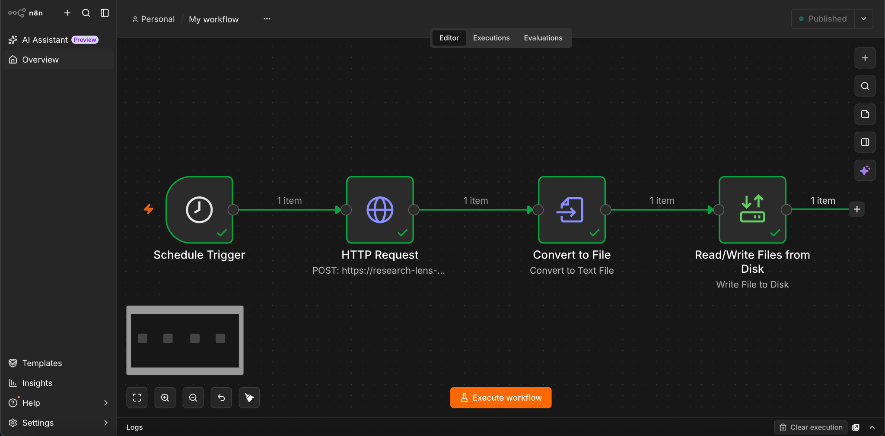
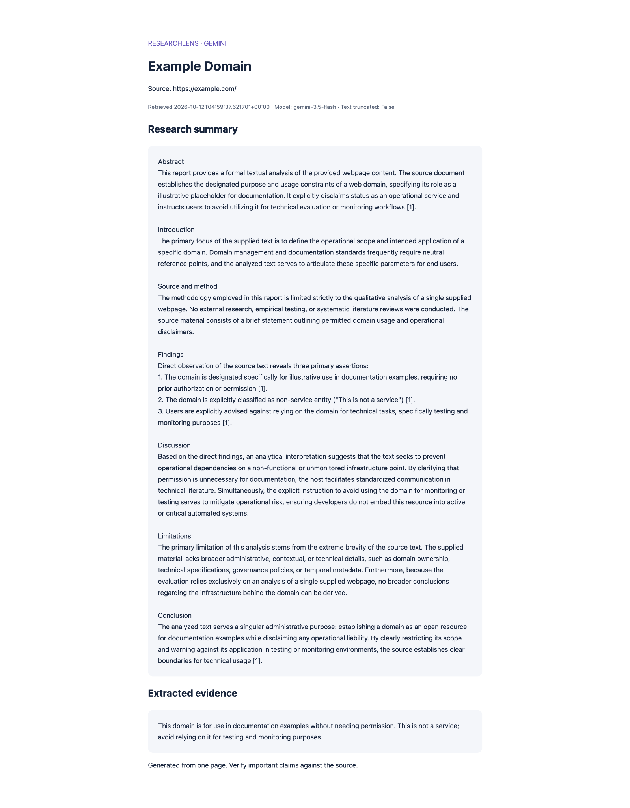
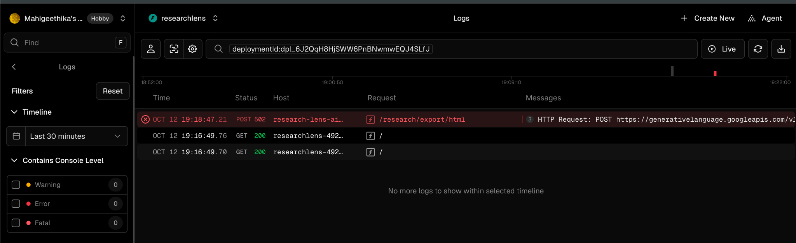
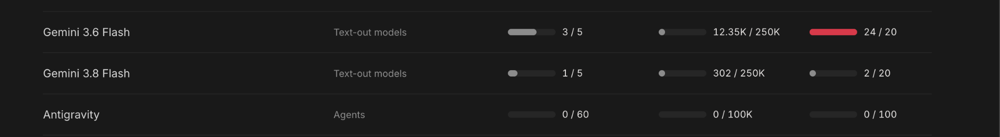

# ResearchLens — AI-Powered Web Research & Report Generator

A portfolio project that turns a permitted HTTPS page into extracted evidence, a focused Gemini summary, and PDF, CSV or formatted HTML reports. Includes a browser interface, interactive FastAPI documentation, and a locally tested n8n workflow for scheduled HTML report generation and storage.

## Quick start

Requires Python 3.10+.

```bash
python -m venv .venv
```

Activate on macOS/Linux:

```bash
source .venv/bin/activate
```

Activate on Windows PowerShell:

```powershell
.venv\Scripts\Activate.ps1
```

Then:

```bash
pip install -r requirements.txt
```

For a new setup, copy `.env.example` to `.env` using your editor. If `.env` already exists, keep it and add `GEMINI_API_KEY` and `GEMINI_MODEL`; do not overwrite your existing settings. Start from the project folder:

```bash
uvicorn app.main:app --reload
```

Open http://127.0.0.1:8000 for the interface or http://127.0.0.1:8000/docs for Swagger. Demo mode is checked by default and uses fictional bundled HTML. It does not fetch a website, contact Gemini, or generate an AI summary.

## Enable real research

Set these in `.env` and restart:

```dotenv
GEMINI_API_KEY=your_real_key
GEMINI_MODEL=gemini-3.8-flash
RESEARCH_API_KEY=choose-a-long-random-secret
```

Use a model your Gemini account can access. API usage has separate billing; never commit `.env`. The default model is a configurable example, not a guarantee of account availability. Enter the endpoint key in the browser form if configured. Uncheck demo and provide an HTTPS page on any public domain. No domain allowlist is required; existing `ALLOWED_DOMAINS` settings are ignored. Private, loopback and other non-public network addresses remain blocked.

Only add sites you own or have permission to extract under their terms. robots.txt is an additional check, not proof of permission. Missing robots.txt (404) permits the fetch; other robots failures stop it. Redirects are rejected: provide the final approved URL. HTML is limited to 2 MB and extracted text to 24,000 characters, with truncation recorded. Pages requiring login or JavaScript rendering are unsupported.

## Architecture

The FastAPI endpoint validates a request and public HTTPS hostname, checks public DNS addresses and robots.txt, fetches HTML with HTTPX, removes irrelevant markup with BeautifulSoup, sends extracted text to the Gemini generateContent API through HTTPX, and returns evidence plus a summary. Exports include source, retrieval timestamp, model and truncation metadata. The browser downloads the already-generated result without another model call.

- `app/main.py`: API, extraction, summarization, exports and errors
- `app/index.html`: browser interface
- `examples/demo.html`: fictional offline fixture
- `tests/test_app.py`: mocked workflow and safety tests
- `.env.example`: environment configuration

## Formal reports and PDF downloads

Live research uses formal academic sections and aims for 1000-1500 words when the evidence supports it. Reports remain single-source AI-assisted analyses, not original research. The interface uses larger reading text and section headings. Download PDF produces an A4 report with source metadata, references, page numbers and an evidence appendix. POST `/reports/pdf` renders an existing research result without fetching or generating again; POST `/research/export/pdf` generates a new result. Install updated requirements before starting the app.

## REST API

| Method | Path | Result |
| --- | --- | --- |
| GET | `/health` | Health status |
| POST | `/research` | JSON research result |
| POST | `/research/export/csv` | CSV attachment |
| POST | `/research/export/html` | Formatted HTML attachment |

Example request (set `demo` to false for live research):

```bash
curl -X POST http://127.0.0.1:8000/research \
  -H "Content-Type: application/json" \
  -H "X-API-Key: your-endpoint-key" \
  -d '{"url":"https://example.com","focus":"Main ideas and limitations","demo":true}'
```

Export directly:

```bash
curl -X POST http://127.0.0.1:8000/research/export/html \
  -H "Content-Type: application/json" \
  -H "X-API-Key: your-endpoint-key" \
  -d '{"url":"https://example.com","demo":true}' \
  -o research-report.html
```

Open an HTML report in a browser and use Print → Save as PDF. Direct PDF export is available through the Download PDF button; it reuses the displayed result without another Gemini request. Each export endpoint runs a fresh research request; use browser downloads to reuse one result.

## Error handling

400 invalid URL/export format; 401 missing endpoint key; 403 network/robots restriction; 413 oversized response; 422 unsupported content or redirect; 502 website/Gemini failure; 503 missing Gemini key; 504 website timeout. FastAPI also validates request bodies. Keys and upstream error bodies are not returned. Model calls have a 45-second timeout and no automatic retries.

## Tests

```bash
python -m pytest -q
```

Tests use bundled data and mocked website/AI responses, with no API costs. They cover extraction, truncation, authentication, DNS checks, robots restrictions, redirects, report escaping, exports and the AI adapter. Live website/Gemini integration requires your network, permission and API credentials.

## Workflow automation with n8n

I built and tested a local n8n workflow that connects ResearchLens's deployed API to automated HTML report generation and local file storage. This extends the browser-based application with a scheduled workflow: request a report, convert the response into a file, and save it for later review.

### Workflow architecture

```text
Schedule Trigger → HTTP Request → Convert to File → Read/Write Files from Disk
```

1. **Schedule Trigger:** starts the workflow at the configured time. The intended daily schedule is **7:00 AM, Asia/Kolkata**. Other times were used during testing; confirm the saved schedule before relying on daily execution.
2. **HTTP Request:** sends a JSON `POST` request to the deployed `/research/export/html` endpoint with a source URL, research focus, and `demo: false` to use live Gemini-backed research.
3. **Convert to File:** uses **Convert to Text File** to turn the returned HTML content into a report file.
4. **Read/Write Files from Disk:** uses **Write File to Disk** to save the HTML report locally.



*Figure 1. The implemented workflow, showing a successful test execution across all four nodes.*

### Local setup and request configuration

I ran n8n on my Mac from the terminal:

```bash
npx n8n
```

The documented deployment endpoint was:

```text
https://research-lens-ai-research.vercel.app/research/export/html
```

The technology-news request was configured as follows:

```json
{
  "url": "https://techcrunch.com/",
  "focus": "Summarize the latest technology industry news, major company announcements, product launches, startup funding, and emerging trends. Include headlines and dates when available. Explain why each development matters and its potential industry impact. Use only information supported by the webpage; do not invent facts.",
  "demo": false
}
```

The tested node setup did not include a custom authentication header. If `RESEARCH_API_KEY` is enabled on a deployment, configure an n8n credential to send `X-API-Key`. The Gemini key stays in the backend environment; it is not part of this request body.

The local output path used during testing was:

```text
~/.n8n-files/ResearchLens/reports/researchlens-report.html
```

The fixed filename means subsequent successful runs overwrite the previous report. Anyone reproducing the workflow should use their own endpoint and a writable output directory. This README documents the implementation; an importable workflow JSON is not included here.

### Generated report and validation

Earlier tests completed the workflow and generated local HTML report files. The example below shows the exported report's title, source URL, retrieval and model metadata, formal research sections, and extracted evidence.



*Figure 2. An example.com output-format test, with gemini-3.5-flash recorded in its metadata. This demonstrates the report output; it does not establish that the later TechCrunch news request completed successfully.*

### Troubleshooting and documented status

**As documented on 12 October 2026:** the workflow was assembled and successfully executed in earlier tests, and HTML reports were saved locally. A later run failed: ResearchLens returned **HTTP 502** to n8n, while the upstream Gemini request returned **HTTP 503 Service Unavailable** for `gemini-3.8-flash`. Unattended daily reliability has not yet been confirmed.

I investigated the failure using Vercel request logs and the Google AI Studio rate-limit dashboard, and checked the deployed model configuration. The recorded 503 indicates an upstream availability failure at that time; it does not establish an invalid API key or prove that quota exhaustion caused that request to fail.



*Figure 3. The Vercel screenshot shows the application's 502 response. The accompanying implementation notes record the upstream Gemini 503; that detail is not fully visible in this screenshot.*



*Figure 4. A historical quota snapshot captured during troubleshooting. These figures are time-specific, not current limits or proof of the cause of the 503.*

### Operational limits and next improvements

- Local scheduling requires n8n to remain running and the Mac to be awake and connected. This setup is not an always-on hosted automation service.
- The workflow currently saves HTML. The application's separate PDF download feature is not demonstrated by this n8n workflow.
- Future improvements include bounded retries with backoff for transient failures, failure notifications, dated filenames for report history, and a continuously running n8n deployment.
- Credentials should stay in backend environment variables or n8n credentials, outside screenshots, workflow exports, and Git commits.

This work demonstrates scheduled workflow design, REST API integration, response-to-file conversion, local report storage, end-to-end testing, and investigation of upstream AI service failures.

## Portfolio demonstration

Record a short walkthrough: run the demo, inspect evidence, download a report, show Swagger and tests, then demonstrate one approved live page with an API key. Add screenshots and your own design decisions to your GitHub README. Explain why evidence, source attribution and limitations matter.

Suggested resume description after running and understanding it: “Built a FastAPI web research tool using BeautifulSoup and the Gemini API, with public HTTPS extraction, source-attributed summaries, CSV/HTML exports and automated tests.”

## Deployment boundaries and improvements

This is a local portfolio starter. Set `RESEARCH_API_KEY` before exposing it. Use HTTPS, strict egress rules, rate limits, authentication and request quotas for public deployment. DNS is checked before fetching but is resolved again by HTTPX: it is not a complete DNS-rebinding defense. An egress proxy that blocks private networks is recommended for deployment. Prompt instructions reduce injection risk but cannot guarantee factual accuracy. Summaries cover one supplied page, not search-engine discovery or multi-source verification. There is no database, job queue or persistent report history.

Possible next steps: multi-source comparisons, SQLite history, background jobs, rate limits, report templates, deployment and evaluation against human-written summaries.

## References

- Gemini generateContent API: https://ai.google.dev/api/generate-content
- FastAPI: https://fastapi.tiangolo.com/
- BeautifulSoup: https://www.crummy.com/software/BeautifulSoup/bs4/doc/
- n8n: https://docs.n8n.io/


## Deploy on Vercel

Deploy the project root as the FastAPI framework, with no custom Build Command or Output Directory. Vercel discovers `app/main.py`; `vercel.json` configures its function duration. Do not use the old custom Python handler or route overrides. All application routes, including `/docs`, `/research/export/pdf`, and `/reports/pdf`, are handled by FastAPI.

Set `GEMINI_API_KEY` and `GEMINI_MODEL=gemini-3.5-flash` in Vercel Project Settings > Environment Variables for Production (and Preview if needed). Local `.env` is excluded from deployments. After changing environment variables or uploading updated code, create a new deployment. Verify `/health` returns `{"status":"ok"}`, then try demo mode before live research. If the backend fails, open the deployment's Runtime Logs and inspect the error for `/research`; browser messages include the HTTP status without revealing internal error bodies.


### Fix `ModuleNotFoundError: No module named app`

The deployed root must contain `main.py`, `pyproject.toml`, `vercel.json`, `requirements.txt`, the entire `app/` folder (including `__init__.py`, `main.py`, `pdf_report.py`, and `index.html`), and `examples/`. The root `main.py` imports the actual application from `app.main`. Do not deploy the contents of `app/` as the project root or move its files out of that folder.

In Vercel Settings > Build and Deployment, set Root Directory to the repository directory containing `requirements.txt` and `vercel.json`, not `app`. Choose FastAPI and clear custom Build Command and Output Directory overrides. Upload or push the complete updated project, then create a new deployment. Set Gemini credentials in Vercel Environment Variables; the deployment archive excludes local secrets.
